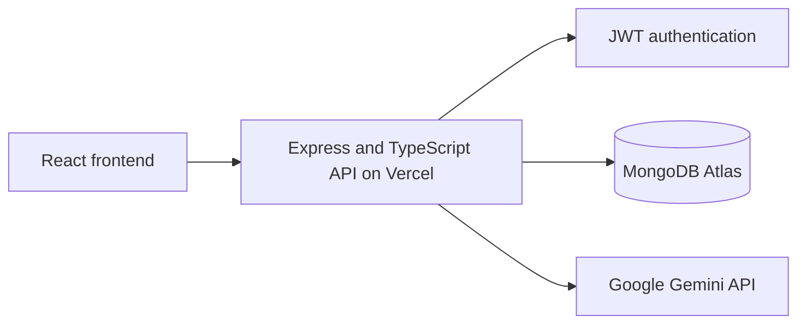

# ITELECT4 Backend API

[](https://github.com/hosakiya/itelect4-backend/actions/workflows/ci.yml)

Express and TypeScript REST API for the DLSL Book Reservation & Academic Catalog System. It handles authentication, catalog and reservation requests, and protected AI reviews.

## Live deployments

- **Backend API:** [https://itelect4-backend-eosin.vercel.app/](https://itelect4-backend-eosin.vercel.app/)
- **Frontend app:** [https://itelect4-project-it4b-gt1.vercel.app/](https://itelect4-project-it4b-gt1.vercel.app/)
- **Backend health check:** [https://itelect4-backend-eosin.vercel.app/api/health](https://itelect4-backend-eosin.vercel.app/api/health)

## Architecture



The frontend calls the API through its request client. Protected routes validate JWTs before using account data. MongoDB stores application data, and the AI route calls Gemini after authentication and rate limiting.

## Environment variables

Copy `.env.example` to `.env` for local development and fill in the values. In Vercel, set the required variables in the backend project's environment settings.

| Variable | Purpose |
| --- | --- |
| `PORT` | Local development server port (defaults to 4000 in code). |
| `MONGODB_URI` | MongoDB Atlas connection string. |
| `MONGODB_DNS_SERVERS` | Optional DNS resolver list for MongoDB connection setup. |
| `JWT_SECRET` | Key used to sign and verify JWTs. |
| `CORS_ORIGIN` | Comma-separated allowed frontend origins. |
| `GEMINI_API_KEY` | Gemini API key for AI reviews. |
| `VERCEL` | Set automatically by Vercel; leave unset for local development. |

Never commit `.env` or expose `GEMINI_API_KEY` in the frontend.

## Run locally

Use Node.js and npm from this repository folder:

```powershell
npm ci
Copy-Item .env.example .env
npm run dev
```

Before starting, fill in `.env`. Set `PORT=4000`, `CORS_ORIGIN=http://localhost:5173`, and configure `MONGODB_URI` and `JWT_SECRET`. Add `GEMINI_API_KEY` to use AI reviews. The frontend runs at `http://localhost:5173` in the sibling `ITELECTGT1P1` repository.

## Checks

```powershell
npm test
npm run typecheck
npm run build
```

## API endpoints

- `GET /api/health` — health check
- `POST /api/auth/register` and `POST /api/auth/login` — account registration and login
- `GET /api/books` and `GET /api/books/:id` — public catalog
- `GET /api/courses` and `GET /api/courses/:code` — course references
- `/api/reservations` — authenticated reservation operations
- `POST /api/ai` — authenticated, rate-limited AI review
- `/api/submissions` — authenticated submission operations

## AI-use disclosure

OpenAI Codex assisted with the implementation and documentation of the tests and CI workflow for this assignment.

## Author

Mikaela Ysabel L. Lantafe | IT4B
